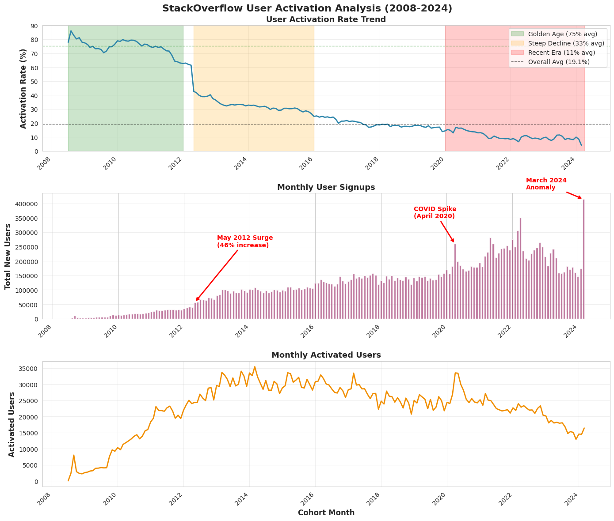
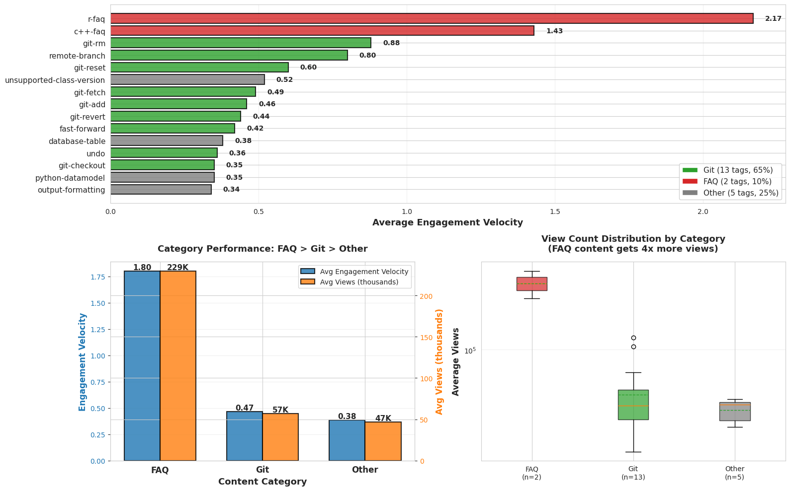
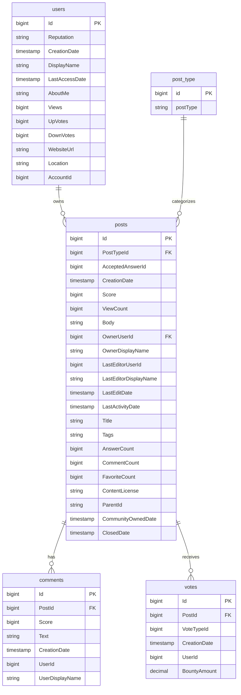
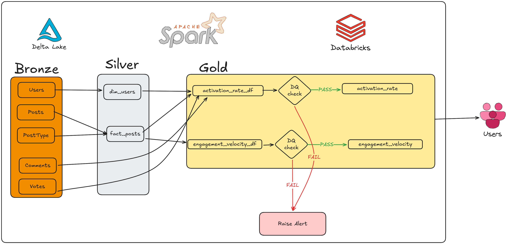
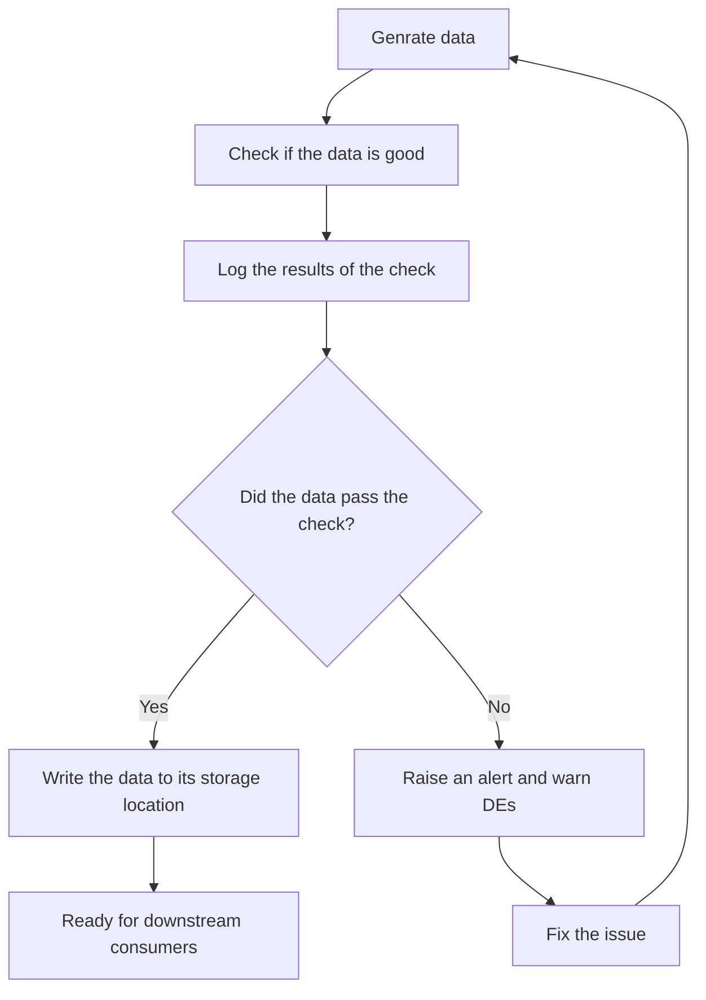

# StackOverflow Data Pipeline

## Objective

Increase customer retention by analyzing high-engagement post patterns and providing personalized post-type recommendations for users.

## Metrics:

1. **User Activation Rate**: % of users who complete the first activity within 30 days of signup. Activity can be a post, a comment, or a vote. Grain: Monthly
2. **Engagement Velocity Score**: Custom metric combining views, answers, scores, and post age. Grain: Post
        Formula: (views + answers×10 + score×5 + comments×3) / hours_since_posted
        Engagement scaled by recency

## Key Findings

Based on analysis of 22.4 million users across 189 months (2008-2024):

1. **Activation Crisis**: User activation has declined 95% from peak (86% → 4%), despite 14x growth in signups
   
2. **The 2012 Turning Point**: May 2012 marked a critical shift where signups surged 46% but activation dropped 31%, suggesting a fundamental change in user acquisition quality

3. **Volume-Quality Trade-off**: While monthly signups grew from 15K (2008) to 215K (2024), activated users peaked at 155K in 2010 and have since declined

4. **Four Distinct Eras**: 
   - Golden Age (2008-2011): 75% activation, small engaged community
   - Recent Era (2020-2024): 11% activation, massive but disengaged audience



Based on engagement analysis of posts across 14 years:

1. Git and FAQ content gets 14-53x more engagement than average questions, dominating 70% of top-performing tags despite representing a tiny fraction of all content.




## Data Model

We pull the following data from StackOverflow's public dataset:

* **ERD**: 



**Source Tables:**
- `Posts`: Questions, answers, and post metadata
- `Users`: User profiles and reputation data
- `Comments`: Discussion on posts
- `Votes`: Up/down votes on posts and comments
- `Tags`: Topic categorization

## Architecture 

We use industry-standard [medallion architecture](https://www.startdataengineering.com/post/de_best_practices/#use-standard-patterns-that-progressively-transform-your-data) to standardize our data transformations.

**Silver Tables (Follows Kimball Data Modeling):**
1. `dim_users`: Dimension table containing user profile and account information
2. `fact_posts`: Fact table containing all Stack Overflow posts with comprehensive metrics and metadata

**Gold Tables (Business Aggregations):**
1. `activation_rate`: Monthly cohort analysis table tracking user activation metrics
2. `engagement_velocity`: Post engagement metrics with custom velocity scoring at post-grain



## Data Quality Checks

- Null checks on key columns (question_id, user_id) in engagement_velocity and activation_rate tables
- Reconciliation check between engagement_velocity and posts to ensure we didn't lose or duplicate rows





## Code Design

We follow **medallion architecture** best practices with clear separation of concerns:

**Folder Structure:**

```
📁 ./
│
├── 📁 assets/
│   └── 📁 images/
│
├── 📁 etl/
│   ├── 📁 bronze/              # Raw ingestion (1:1 with source)
│   │   └── setup_bronze_tables.py
│   │
│   ├── 📁 silver/              # Cleaned and conformed
│   │   ├── dim_users.py
│   │   └── fact_posts.py
│   │
│   └── 📁 gold/                # Business-level aggregations
│       ├── activation_rate.py
│       ├── engagement_velocity.py
│
├── 📁 visualization/
│   ├── activation_rate.py
│   └── engagement_velocity.py
│
├── run_pipeline_dbx.ipynb
├── run_pipeline.ipynb
└── README.md
```
**Pipeline Pattern** (consistent across all tables):
                      

```python

def extract(spark):
    """Load all required upstream tables into a dictionary"""
    # returns a dict with name -> dataframe of all the upstream tables

def transform(spark, upstream_data):
    """Apply business logic and transformations"""
    # performs transformations and returns the transformed dataframe

def load(spark, table_df, table_name):
    """Write transformed data to Delta Lake table"""
    # loads the transformed dataframe into the destination table

def data_quality_check(spark, transformed_df):
    """Run data Quality checks"""
    # Runs DQ checks with Spark and returns True or False 

def run(spark, table_name):
    """Main orchestration function"""
    upstream_data = extract(spark)
    transformed_data = transform(spark, upstream_data)
    if data_quality_check(spark, transformed_data):
        raise Exception("Data Quality Check Failed")
    load(spark, transformed_data, table_name)
```

**Benefits:**
- **Testable**: Each function can be unit tested independently
- **Reusable**: Pattern works across all pipeline stages
- **Debuggable**: Easy to inspect data at each transformation step


## Running the Pipeline

**Local Development:**

```bash
docker compose up --build -d --scale spark-worker=2
open http://localhost:8888/tree
# Open a run_pipeline.ipynb to run the pipeline end-to-end
```

**Databricks:**

1. Create a free Databricks account
2. Go to Workspace -> Create -> Git folder and paste your GitHub repository's https link
3. Now you can run `run_pipeline_dbx.ipynb`

add: screenshot

## Next Steps 

1. **Add code tests** - Validate transformation logic works correctly
2. **Setup CI/CD** - Automate testing and deployment 
3. **Create a base class** - Reduce code duplication across pipelines
4. **Add business data quality checks** - Detect outliers and anomalies automatically
5. **Pipeline monitoring** - Track job failures, runtime, and data quality metrics with alerts
